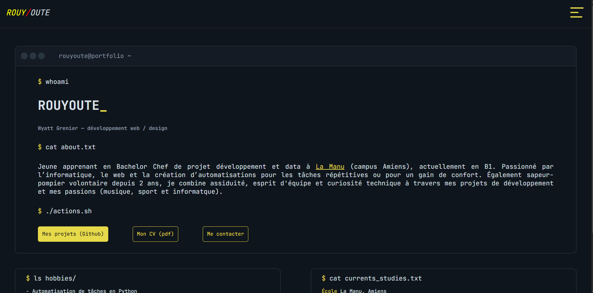

# ROUYOUTE — Portfolio
 
Portfolio personnel de **Wyatt Grenier**, étudiant en Bachelor Chef de projet développement & data à [La Manu](https://lamanu.fr/) (campus d'Amiens).
 
Le site reprend l'univers d'un terminal : prompts `$ cd ~/parcours`, fenêtre avec les trois ronds, police monospace et accent jaune.
 
🔗 **Site en ligne : [rouyoute-portfolio.web.app](https://rouyoutedev.github.io/PORTFOLIO/)**
 

 
## Pages
 
| Page | Fichier | Contenu |
|---|---|---|
| À propos | `index.html` | Présentation, hobbies, études en cours, accès rapide (GitHub, CV, contact) |
| Parcours | `parcour.html` | Formation, sapeur-pompier volontaire, stage, compétences |
| Projets | `projects.html` | Projets d'école et projets personnels, avec code et démo |
| Contact | `contact.html` | Formulaire et coordonnées |
 
## Technologies
 
- HTML5
- CSS3 (CSS imbriqué, variables, grid et flexbox)
- JavaScript (menu burger)
- Responsive : un fichier CSS pour le téléphone et un pour le PC, pour chaque page
- Police [JetBrains Mono](https://www.jetbrains.com/lp/mono/) (Google Fonts)
 
## Structure du projet
 
```
.
├── index.html
├── parcour.html
├── projects.html
├── contact.html
├── base.html              # modèle de page de départ
└── assets/
    ├── css/               # style.css + un fichier _pc et _phone par page
    ├── js/burgerMenu.js   # ouverture et fermeture du menu
    ├── imgs/              # icône, curseur, burger et aperçus des projets
    └── doc/               # CV (PDF)
```
 
## À venir
 
- [ ] Formulaire de contact fonctionnel (en attente d'un back-end)
- [ ] Lien LinkedIn
- [ ] Nouveaux projets


## Contact
 
- 📧 [grenier.wyatt@gmail.com](mailto:grenier.wyatt@gmail.com)
- 🐙 [github.com/RouyouteDev](https://github.com/RouyouteDev)
 
